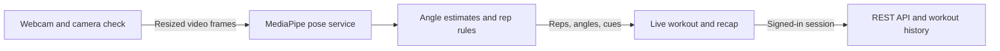

# Reform

**What we verified about the workout angles:** Reform passed 27 geometry and rep-counting checks across five exercises and four pose-service checks, including a real-person image sent through the WebSocket. Reform also counted one rep on a recorded University of Idaho deep squat. On that clip, the side-view knee angle differed from the 3D angle calculated from the same joints by **7.9° on average**, with a **38.4°** worst frame. We checked the counting targets against published exercise guidance. These results do not establish webcam accuracy across people and devices. See the [exercise targets, sources, and validation plan](docs/pose-validation.md).

Reform is a webcam workout coach for squats, standard floor push-ups, single-arm bicep curls, forward lunges, jumping jacks, shoulder presses, lateral raises, and glute bridges, plus timed planks, side planks and wall sits (time only counts while you hold a good position). It estimates joint angles, counts reps in planned sets with a 3-2-1 start and rest timer, grades every rep, and offers on-screen and optional spoken cues. The skeleton turns red on the joints behind a live fault.

Workouts are hands-free once the camera check starts: the camera fills the screen, the workout begins by itself when you hold the start position, each set starts after a 3-2-1 once you're back in view, rest counts down, and the app moves on to the next exercise and then the summary. A live gauge shows the tracked joint angle against the rep goal (rounded to 5°, since camera angles are estimates) and says which way to move. The summary lists every fault with how many reps showed it; Progress shows personal records (best set, longest hold, heaviest weight) and your day streak. Optional voice commands (Chrome, Edge and Safari) let you say *pause*, *resume*, *skip*, *next* or *stop*. You can train and view your history and progress without an account. Guest workouts are stored in the browser you use to train.

## Run locally

Use Node.js 20+ and 64-bit Python 3.11 or 3.12. Start the pose service in one terminal:

```powershell
cd ai-engine
python -m venv .venv
.\.venv\Scripts\python.exe -m pip install -r requirements-dev.txt
.\.venv\Scripts\python.exe main.py
```

On macOS or Linux, use `.venv/bin/python` in the last two commands. `requirements-dev.txt` adds the test and training tools; the hosted service installs only `requirements.txt`. The MediaPipe model is included, and the service listens on port 8000.

Start the frontend in another terminal:

```sh
cd frontend
npm ci
npm run dev
```

Open [http://localhost:5173](http://localhost:5173), choose **Start Workout**, and allow camera access. Follow the camera guide for the selected exercise. If the app says tracking is offline, check [the pose-service health endpoint](http://localhost:8000/health).

### Optional account sync

1. Enable the Email/Password or Google provider in your Firebase project. Add your frontend domain to Firebase's authorized domains.
2. Run [the Reform schema](backend/sql/001_reform.sql) in your Supabase project's SQL Editor. Use the **Connect** dialog to obtain the session pooler URI for a local server or the transaction pooler URI for serverless hosting.
3. Copy the frontend variables in [`.env.example`](.env.example) into `frontend/.env`, and the backend variables into `backend/.env`. Configure the same Firebase project on both and set `SUPABASE_DATABASE_URL` only on the backend. If the URI omits the password, set `SUPABASE_DATABASE_PASSWORD` separately.
4. From `backend/`, run `npm ci` and `npm start`. Check [the backend health endpoint](http://localhost:5000/api/health) for the Supabase and Firebase connection status.

For hosting, serve the frontend over HTTPS, set `VITE_AI_ENGINE_WS_URL` to the `wss://` endpoint, and allow the exact frontend origin in `AI_CORS_ORIGINS` on the pose service. Set `CLIENT_URL` on the REST backend and `VITE_API_URL` on the frontend. If you change the frontend port, update both allowed origins. Camera frames are processed in memory by the pose service; the workout database stores session statistics.

## How tracking works



Reform counts a rep once it sees the starting position, the range target, and the return. A pause, missing joint, or tracking gap interrupts the unfinished rep. Reform reads a straight knee or elbow as 180°; many studies call this 0° of flexion. Each counted rep gets a score out of 100 and a grade (A ≥ 90, B ≥ 80, C ≥ 65, D below):

- **Range (40):** reaching the counted target earns 28; reaching the fuller ideal range earns all 40.
- **Control (20):** half marks at the minimum rep duration, full marks at twice that.
- **Faults (40):** each fault costs points in proportion to how much of the rep it was seen (for example a sagging hip in a push-up or uneven arms in a lateral raise).

The score summarizes these camera estimates, so 100% does not certify exercise form. Sessions saved before rule version 3 were scored with older rules.

The experimental exercise classifier is disabled during workouts. Its score at `/api/evaluation` describes performance on synthetic training data.

## Verify changes

- **Pose rules and API:** From `ai-engine/`, run `python -m pytest -q` inside the virtual environment. The optional real-person test runs if `REFORM_TEST_IMAGE` points to [MediaPipe's pose sample](https://storage.googleapis.com/mediapipe-assets/pose.jpg); with it, 31 tests run.
- **Recorded squat:** Follow the replay instructions in [the validation notes](docs/pose-validation.md).
- **Frontend:** Run `npm run build` from `frontend/`. Check a guest session through camera setup, live reps, pause, an exercise switch, and recap. In a signed-in session, also check Profile, save, and history.
- **Backend:** Run `npm test` from `backend/`. The integration test runs the Reform schema in an in-memory PostgreSQL database and uses emulator-style Firebase tokens.

The desktop and mobile browser walkthrough passed with a simulated camera and account services. The Express integration test covers preferences, saving, history, analytics, and ownership. A physical camera and your hosted Supabase and Firebase projects still need a manual check.

## Next work

The [handoff](docs/handoff.md) records the visual direction, the remaining filmed validation, and the dedicated **Workout Tracker** planned for logging sets, reps, weights, and notes.
