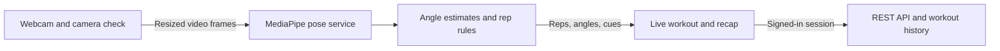

# Reform

**What we verified about the workout angles:** Reform passed 27 geometry and rep-counting checks across five exercises and four pose-service checks, including a real-person image sent through the WebSocket. Reform also counted one rep on a recorded University of Idaho deep squat. On that clip, the side-view knee angle differed from the 3D angle calculated from the same joints by **7.9° on average**, with a **38.4°** worst frame. We checked the counting targets against published exercise guidance. These results do not establish webcam accuracy across people and devices. See the [exercise targets, sources, and validation plan](docs/pose-validation.md).

Reform is a webcam workout coach for squats, standard floor push-ups, single-arm bicep curls, forward lunges, and jumping jacks. It estimates joint angles, counts reps, and offers on-screen and optional spoken cues. Guests can run a full session without an account; signed-in users can save their recap and see it in history and progress.

## Run locally

Use Node.js 20+ and 64-bit Python 3.11 or 3.12. Start the pose service in one terminal:

```powershell
cd ai-engine
python -m venv .venv
.\.venv\Scripts\python.exe -m pip install -r requirements.txt
.\.venv\Scripts\python.exe main.py
```

On macOS or Linux, use `.venv/bin/python` in the last two commands. The MediaPipe model is included, and the service listens on port 8000.

Start the frontend in another terminal:

```sh
cd frontend
npm ci
npm run dev
```

Open [http://localhost:5173](http://localhost:5173), choose **Start Workout**, and allow camera access. Follow the camera guide for the selected exercise. If the app says tracking is offline, check [the pose-service health endpoint](http://localhost:8000/health).

### Sign-in and saved workouts

1. Enable the Email/Password or Google provider in your Firebase project. Add your frontend domain to Firebase's authorized domains.
2. Copy the frontend variables in [`.env.example`](.env.example) into `frontend/.env`, and the backend variables into `backend/.env`. Configure the same Firebase project on both and set `MONGODB_URI` on the backend.
3. From `backend/`, run `npm ci` and `npm start`. Check [the backend health endpoint](http://localhost:5000/api/health) for the MongoDB and Firebase configuration status.

For hosting, serve the frontend over HTTPS, set `VITE_AI_ENGINE_WS_URL` to the `wss://` endpoint, and allow the exact frontend origin in `AI_CORS_ORIGINS` on the pose service. Set `CLIENT_URL` on the REST backend and `VITE_API_URL` on the frontend. If you change the frontend port, update both allowed origins. Camera frames are processed in memory by the pose service; the workout database stores session statistics.

## How tracking works



Reform counts a rep once it sees the starting position, the range target, and the return. A pause, missing joint, or tracking gap interrupts the unfinished rep. Reform reads a straight knee or elbow as 180°; many studies call this 0° of flexion. The form score summarizes the configured visual cues, so 100% does not certify exercise form. Older sessions were scored using different rules.

The experimental exercise classifier is disabled during workouts. Its score at `/api/evaluation` describes performance on synthetic training data.

## Verify changes

- **Pose rules and API:** From `ai-engine/`, run `python -m pytest -q` inside the virtual environment. The optional real-person test runs if `REFORM_TEST_IMAGE` points to [MediaPipe's pose sample](https://storage.googleapis.com/mediapipe-assets/pose.jpg); with it, 31 tests run.
- **Recorded squat:** Follow the replay instructions in [the validation notes](docs/pose-validation.md).
- **Frontend:** Run `npm run build` from `frontend/`. Check a guest session through camera setup, live reps, pause, an exercise switch, and recap. In a signed-in session, also check Profile, save, and history.
- **Backend:** With disposable MongoDB running locally, set `REFORM_TEST_MONGODB_URI` to its loopback URI (for example, `mongodb://127.0.0.1:27019`) and run `npm test` from `backend/`. This uses an isolated test database and emulator-style Firebase tokens. It does not use your real account or database.

The desktop and mobile browser walkthrough passed with a simulated camera and account services. The Express integration test passed against local MongoDB for preferences, saving, history, analytics, and ownership. A physical camera and your deployed Firebase project still need a manual check.

## Next work

The [handoff](docs/handoff.md) records the visual direction, the remaining filmed validation, and the dedicated **Workout Tracker** planned for logging sets, reps, weights, and notes.
